# ▶️ Content Opportunity Finder

**Turns YouTube comments into 3 video ideas a week for AI creators.**
Congrui Liu · NTU Module 3 project

| 🚀 Live dashboard | 📑 Slides | 📚 Full write-up |
|---|---|---|
| **[content-opportunity-finder.streamlit.app](https://content-opportunity-finder.streamlit.app/)** | [PDF](slides/CongruiLiu_Project3_Content_Opportunity_Finder_1105_Final.pdf) · [PPTX](slides/CongruiLiu_Project3_Content_Opportunity_Finder_1105_Final.pptx) · [all 13 slides below](#-presentation-13-slides) | [docs/01 … docs/11](docs/), one file per point of the brief |

[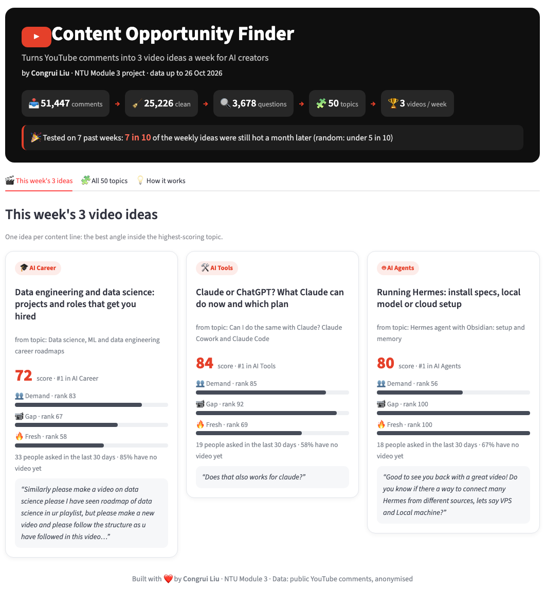](https://content-opportunity-finder.streamlit.app/)

---

## 🗺️ Project structure at a glance

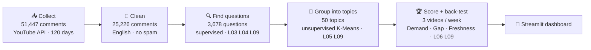

**My hypothesis:** a video is worth making when the comments show 3 signals.

| 👥 Demand | 📹 Gap | 🔥 Freshness | = Opportunity |
|---|---|---|---|
| many people ask it | asked, but no video yet | rising this week | worth filming now |
| 45% | 35% | 20% | one score per topic |

### How this README follows the Module 3 brief

The brief asks the README for 5 parts; the 11 presentation points sit inside them. Each point has a short summary here, a full page in `docs/` and a slide.

| README part (brief §12) | Presentation point | Here | Full page | Slide |
|---|---|---|---|---|
| **Project overview and problem statement** | 1 Problem statement | [§1](#1-problem-statement) | [docs/01](docs/01_problem_statement.md) | 1 |
| | 2 Type of ML problem | [§2](#2-type-of-ml-problem) | [docs/02](docs/02_ml_problem_type.md) | 1, 4, 8, 11 |
| **Dataset description and how to obtain it** | 3 Dataset | [§3](#3-dataset) | [docs/03](docs/03_dataset.md) | 2, 4 |
| **Instructions to set up and reproduce** | – | [Setup](#-instructions-to-set-up-the-environment-and-reproduce-the-results) | – | – |
| **Summary of results** | 4 EDA findings | [§4](#4-eda-findings) | [docs/04](docs/04_eda.md) | 3 |
| | 5 Feature engineering | [§5](#5-feature-engineering) | [docs/05](docs/05_feature_engineering.md) | 2, 6 |
| | 6 Models tried | [§6](#6-models-tried) | [docs/06](docs/06_models.md) | 5, 6, 8, 9 |
| | 7 Hyperparameter tuning | [§7](#7-hyperparameter-tuning) | [docs/07](docs/07_tuning.md) | 6 |
| | 8 Evaluation metrics | [§8](#8-evaluation-metrics) | [docs/08](docs/08_evaluation.md) | 5, 7, 10, 12 |
| | 9 Opportunity sizing | [§9](#9-opportunity-sizing) | [docs/09](docs/09_opportunity_sizing.md) | 13 |
| | 10 Recommendation | [§10](#10-recommendation-deploy-or-not) | [docs/10](docs/10_recommendation.md) | 13 |
| | 11 Deployment plan | [§11](#11-deployment-plan) | [docs/11](docs/11_deployment_plan.md) | 13 |
| **Repository structure** | – | [Structure](#-repository-structure) | – | – |

Beyond the brief, the project adds: a **time-based back-test of the weekly picks** (slide 12), a **choice of K by business rules** when the data shows no natural K (slide 9), and a **follow-up check that the topics still fit new data** (slide 10).

---

## 📌 Project overview and problem statement

### 1. Problem statement
- **Who is affected:** an AI YouTube creator (me) with 3 content lines: AI Career, AI Tools, AI Agents.
- **Problem:** viewers leave thousands of comments; the same question comes in many different words. Reading them by hand takes **about 3 hours a week**.
- **Decision the model supports:** **which 3 videos to make each week**, one per content line, backed by real viewer questions. The creator makes the final pick.
- **Baseline today:** reading comments by hand. For the ML step, the baseline is a simple rule: **"a comment with '?' is a question"**.

### 2. Type of ML problem
| | Step 1: find questions | Step 2: group into topics | Step 3: score and pick |
|---|---|---|---|
| Type | **supervised** | **unsupervised** | rule-based score, checked by a back-test |
| Task | **binary classification**: question (1) or not (0) | clustering (K-Means) | ranking |
| Why | labelled examples exist | no answer key for topics | no label for "a good video" |

**Weekly batch**, not real-time. Not a forecast, but **time order matters**: train Jul–Sep, test October, back-test on past Mondays (L06).

---

## 📦 Dataset description and how to obtain it

### 3. Dataset
- **Source:** official YouTube Data API v3; 3 content lines × 5 real search words (e.g. *"how to get a job in AI"*).
- **Period:** 120 days, **28 Jun – 26 Oct 2026**.
- **Size:** 51,447 comments × 6 columns, from 1,282 videos (15 columns) and 893 channels.
- **Cleaning: 51,447 → 25,226** (about half was noise): English videos and comments only, at least 5 words, Hindi written in English letters removed, spam removed.
- **Split by time on 28 Sep:** train Jul–Sep (16,523) · test October (8,703). A random split would leak October into training.
- **Target `is_need`:** 1 = the viewer asks for something a video could give. **493 labelled comments**: train 356 (74 questions, 21%) · test 137 (19 questions, 14%).
- **Limitations:** class imbalance (21%), few labels, English only, search favours big channels.
- **Privacy:** author names are never stored, only a salted hash (HMAC) used to count different people.

**How to obtain it.** Raw comments are not in this repository (large, and they change every week). To collect your own:
1. Get a YouTube Data API key from Google Cloud.
2. Copy `.env.example` to `.env` and fill in `YOUTUBE_API_KEY` and `AUTHOR_SALT`.
3. Run `python -m src.pipeline --collect`. One run uses about 7,000 of the 10,000 free daily API units.

**Included in the repository:**

| Path | What it is |
|---|---|
| `data/labels/need_labels.csv` | the labelled comments (question 1 / not 0) |
| `data/labels/coverage_pairs_labelled.csv` | 150 checked comment–video title pairs, used to choose the 0.60 gap cut-off |
| `data/labels/topic_names.csv` | the 50 topic names |
| `results/` | topic-method comparison (ARI), back-test summary, this week's picks |
| `app/data/` | a small anonymised snapshot for the public dashboard |

---

## 🛠 Instructions to set up the environment and reproduce the results

```bash
python -m venv .venv
source .venv/bin/activate          # Windows: .venv\Scripts\activate
pip install -r requirements.txt

python -m src.baseline_question_mark   # "?" baseline from the labels only: train F0.5 0.59, October test 0.45
python -m src.pipeline --collect       # collect data, then run every step
python -m src.pipeline                 # re-run every step on data already collected
python -m src.compare_filter_models    # side-by-side models on the training labels
```

`src.pipeline` runs, in order:
1. `preprocess`: clean the data and split it by time;
2. `embed`: MiniLM embeddings;
3. `need_classifier`: features, models, 5-fold CV, grid search, threshold, one final test;
4. `clustering`: 4 methods, ARI, K-Means topics;
5. `supply`: match recent videos to topics;
6. `backtest`: 7 past Mondays + final check;
7. `monitoring`: weekly topic fit;
8. `recommend`: weekly Top 3;
9. `subtopics`: one video angle per pick.

The random seed is fixed (`RANDOM_STATE = 42` in `src/config.py`).

**Dashboard** (live: [content-opportunity-finder.streamlit.app](https://content-opportunity-finder.streamlit.app/)):

```bash
cd app && pip install -r requirements.txt && streamlit run app_public.py
```

---

## 📊 Summary of results

| Question | Result |
|---|---|
| Does the question filter beat the "?" rule on unseen October data? | **Yes:** gradient boosting F0.5 **0.71 vs 0.45**; caught 13 of 19 real questions vs 10 |
| Group by words or by meaning? | **Meaning** was the steadiest (ARI) in all 3 content lines |
| How many topics? | No natural K in the data, so 2 business rules: **15 + 20 + 15 = 50 topics** |
| Do the topics still fit new data? | **78–88%** of October questions fit the old topics (Jul–Sep: 90%) |
| Are the weekly picks any good? | On 7 past Mondays, **44 of 63 picks (70%)** were still hot a month later (random: 47%) |
| Value | Saves **2.5 h a week** (130 h a year); pays back in about 6 months |
| Recommendation | **Deploy now as a decision aid; roll out the ranking only if an 8-week A/B test wins** |
| Main limit | Few labels (only 19 test questions); next step: label more |

### 4. EDA findings
| Finding | Evidence | What it changed |
|---|---|---|
| Same meaning, different words | "Is this really free?" vs "Do I have to pay for it?": TF-IDF 0 shared words, MiniLM 0.54 | group by **meaning** (MiniLM, L09) |
| No clear groups | PCA on AI Career: one cloud; silhouette 0.02–0.09 | **no natural K**: choose K by business rules |
| One video fakes a trend | 53% of training comments sit under 10% of the videos | count **people**, max 3 per video |

### 5. Feature engineering
- Text → numbers: **TF-IDF** (keeps *how / what / can*) and **all-MiniLM-L6-v2** embeddings (384 numbers, L09).
- MiniLM sees the topic, not the intent, so **3 rules** were added: has "?", starts with how / what / can, says please / help → **387 features**.
- CV F0.5 (logistic regression): TF-IDF 0.61 · MiniLM 0.45 · **MiniLM + 3 rules 0.64**.
- **No leakage:** split by time; TF-IDF fitted inside each CV fold; topics learned on Jul–Sep only; October test opened once.

### 6. Models tried
Step 1, find questions (5-fold stratified CV on 356 training labels):

| Model | Precision | Recall | CV F0.5 | vs baseline |
|---|---|---|---|---|
| Baseline: "?" only | 0.61 | 0.54 | 0.59 | – |
| Logistic regression (L03) | 0.75 | 0.41 | 0.64 | +0.05 |
| Random forest (L04) | 0.79 | 0.30 | 0.59 | ±0 |
| **Gradient boosting (L04)** | 0.75 | 0.49 | **0.68** | **+0.09** |

Step 2, group 2,574 Jul–Sep questions. Stability by ARI (5 runs, every pair compared):

| Method | AI Career | AI Tools | AI Agents |
|---|---|---|---|
| By words: TF-IDF + K-Means (baseline) | 0.30 | 0.23 | 0.43 |
| By meaning: MiniLM + K-Means (L09) | 0.37 | 0.47 | **0.58** |
| By meaning + PCA (L05) | **0.49** | **0.53** | 0.49 |
| HDBSCAN* (leaves 15–32% in no group) | 0.34 | 0.51 | 0.21 |

K per content line: the elbow has no bend and silhouette is 0.03–0.09, so K follows 2 rules: the biggest topic ≤ 12% (1 video can cover it) and 10–25 topics. → **AI Career 15 · AI Tools 20 · AI Agents 15**.

\* beyond the course

### 7. Hyperparameter tuning
- **Grid search + 5-fold CV** (L04) on learning rate × depth: default 0.65 → **0.68** (+0.03, smaller than the CV noise SD 0.10).
- **Biggest effect: leaf size** (`min_samples_leaf`): 1 → 0.57, 20 → **0.68**. With 356 rows and 387 features, tiny leaves memorise single comments.
- The October test stayed sealed during tuning.

### 8. Evaluation metrics
- Only 21% are questions, so **accuracy misleads**. Fake questions inflate a topic, so **precision first**: rank by **F0.5**, pass at precision ≥ 75%.
- **CV:** 0.68 ± 0.10. The gap over the baseline (0.09) is smaller than the SD, so the test decides.
- **Held-out October test (opened once):**

| | Caught | False alarms | F0.5 |
|---|---|---|---|
| **Gradient boosting** | 13 of 19 | 5 | **0.71** |
| "?" rule | 10 of 19 | 13 | 0.45 |

- Test gap 0.26 > SD 0.10 → really better; CV 0.68 → test 0.71 → no overfitting.
- **Error analysis:** missed questions have no "?"; false alarms are rhetorical questions; AI Career has 7 of 11 errors.
- **Topics on new data:** 88% / 78% / 81% of October questions fall inside the Jul–Sep topic rings (reference: 90%).
- **Back-test (L06):** 7 past Mondays × 3 lines × Top 3 = 63 picks; hit = more people asking than half the topics in its line over the next 4 weeks. **Ours 70% vs random 47%.**

### 9. Opportunity sizing
Research drops from ~3 h to ~0.5 h a week → **130 h a year saved**. Build ~50 h + 2 h a month upkeep → net ~106 h a year → **pays back in about 6 months**.

### 10. Recommendation: deploy or not
**Deploy now as a decision aid** (a person approves every pick; a wrong pick costs one video slot). **Roll out the ranking only if the A/B test wins.** Risks: few labels, comments are not views, topic drift, English-only bias.

### 11. Deployment plan
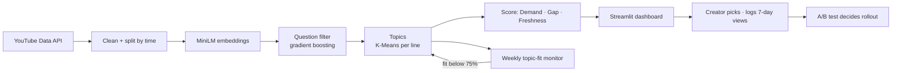
- **Weekly batch:** `python -m src.pipeline --collect`, about 10 minutes on a laptop.
- **Drift:** topic fit below 75% → re-cluster; new labels → retrain and re-test on time-split data.
- **A/B test:** A = most-asked topic, B = our pick; metric = 7-day views; at least 8 weeks; roll out if B ≥ 1.1× A, roll back if B < 0.9× A.

---

## 🎤 Presentation (13 slides)

[PDF](slides/CongruiLiu_Project3_Content_Opportunity_Finder_1105_Final.pdf) · [PPTX](slides/CongruiLiu_Project3_Content_Opportunity_Finder_1105_Final.pptx)

| | | |
|---|---|---|
| **1 Overview**<br/>[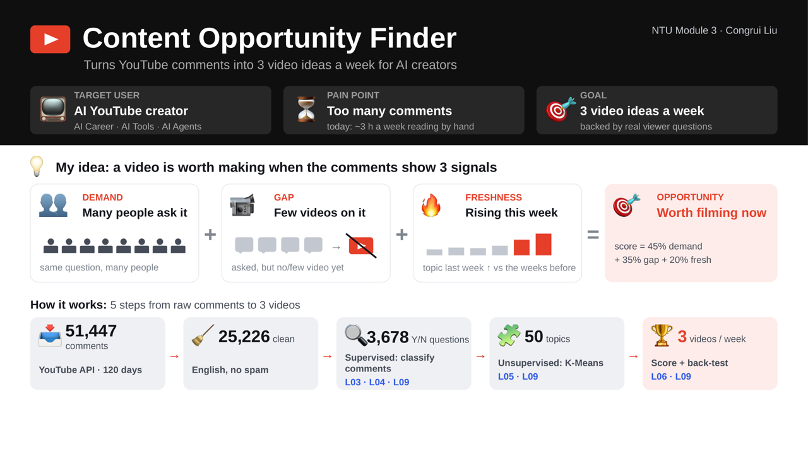](slides/images/slide_01.png) | **2 Data**<br/>[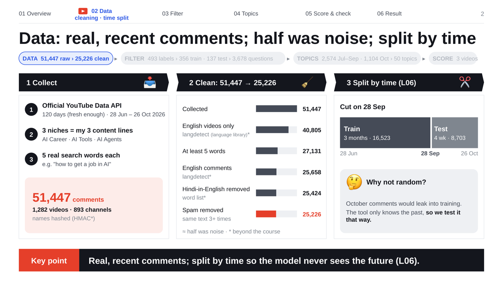](slides/images/slide_02.png) | **3 EDA**<br/>[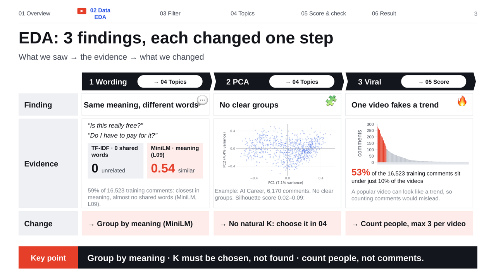](slides/images/slide_03.png) |
| **4 Labels**<br/>[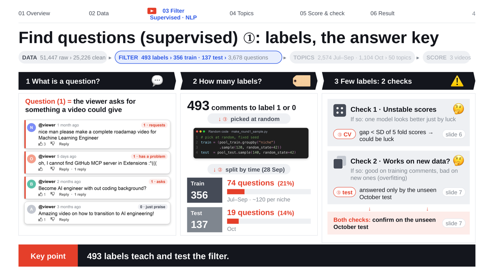](slides/images/slide_04.png) | **5 How we grade**<br/>[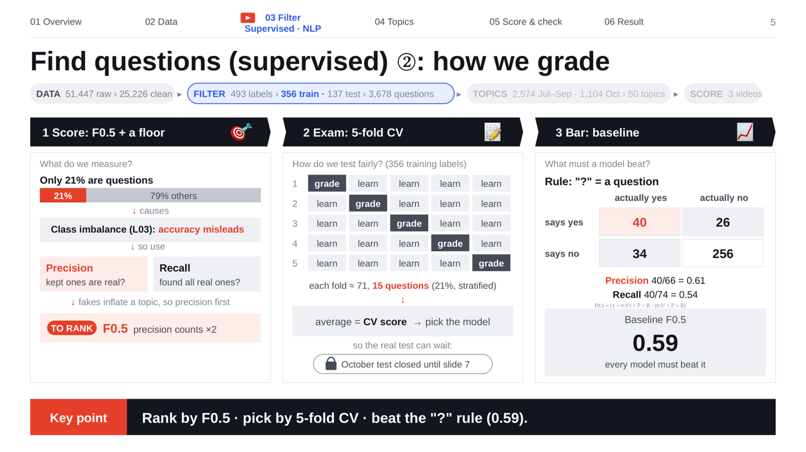](slides/images/slide_05.png) | **6 Features, model**<br/>[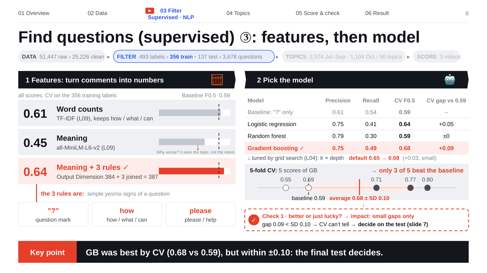](slides/images/slide_06.png) |
| **7 Final exam**<br/>[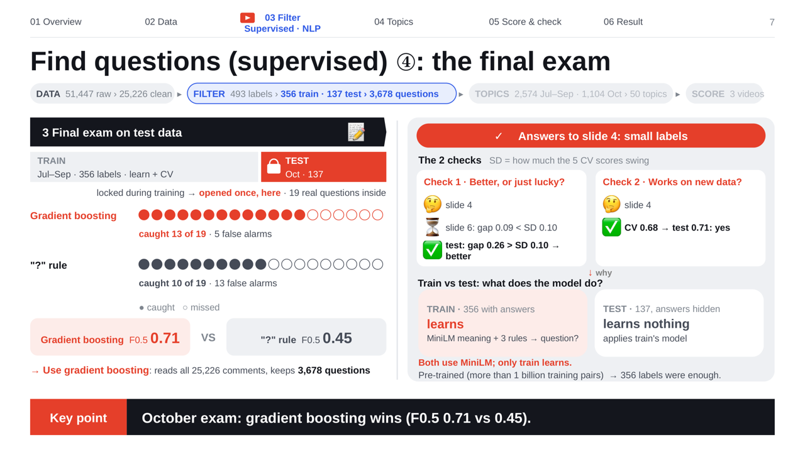](slides/images/slide_07.png) | **8 Words or meaning**<br/>[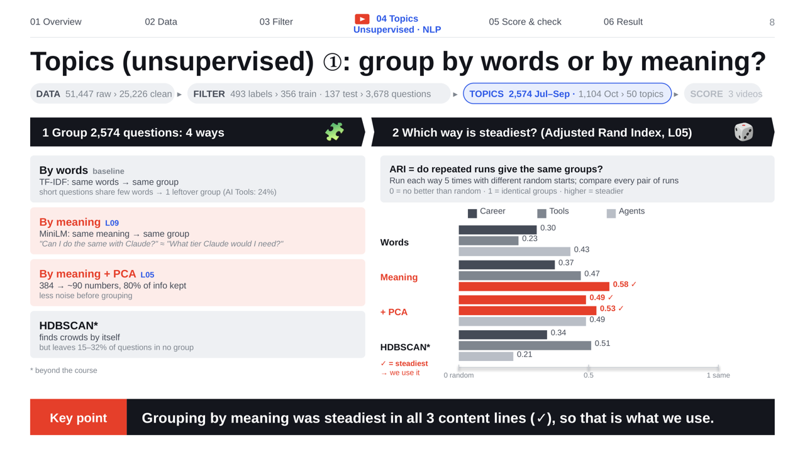](slides/images/slide_08.png) | **9 Choose K**<br/>[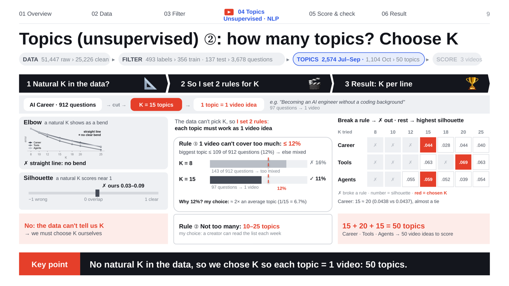](slides/images/slide_09.png) |
| **10 Fit October?**<br/>[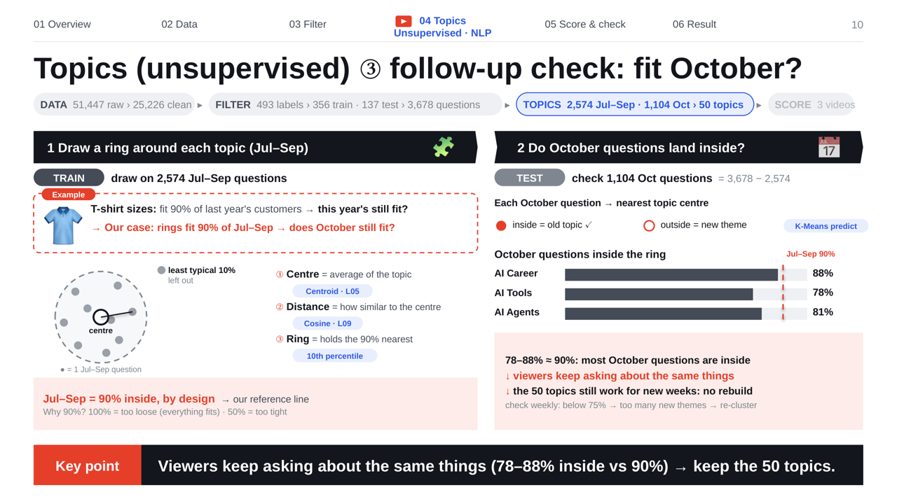](slides/images/slide_10.png) | **11 Score**<br/>[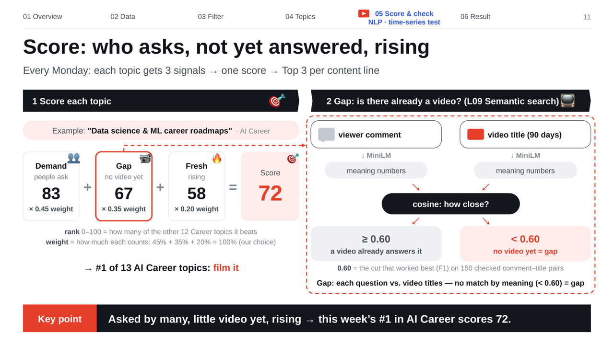](slides/images/slide_11.png) | **12 Back-test**<br/>[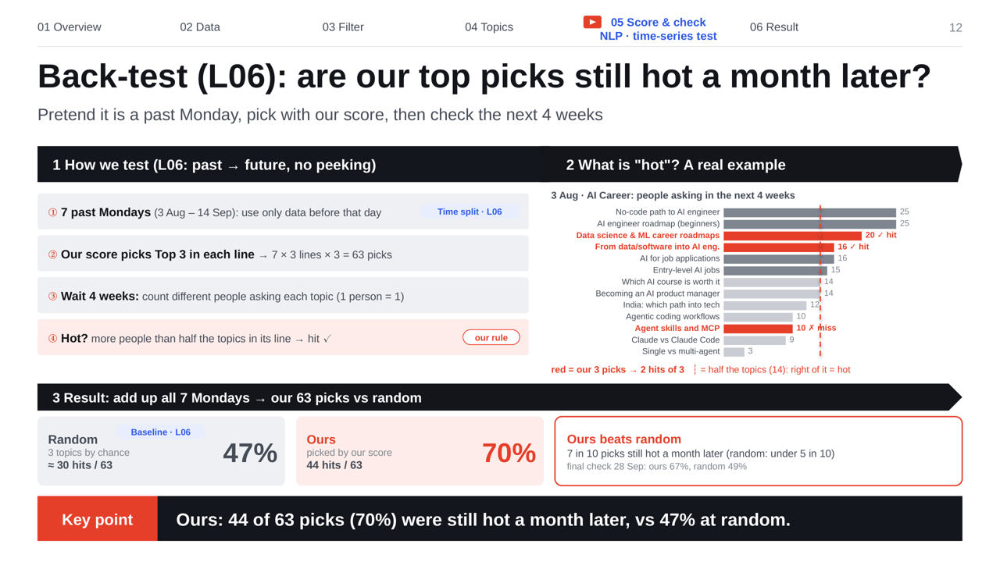](slides/images/slide_12.png) |
| **13 Go live**<br/>[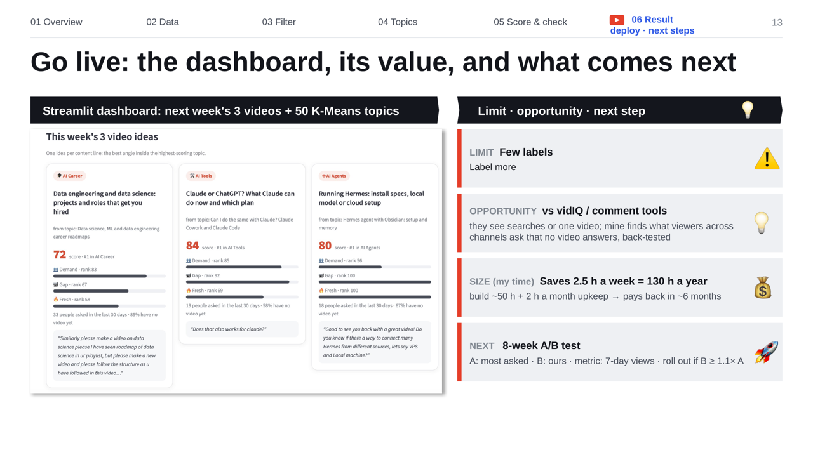](slides/images/slide_13.png) | | |

---

## 📁 Repository structure

```
Content Opportunity Finder/
├── README.md                 you are here
├── docs/                     points 1–11 of the brief, one file each (01_… to 11_…)
│   └── images/               dashboard screenshot
├── slides/                   final presentation: .pptx + .pdf
│   └── images/               one PNG per slide
├── app/                      public Streamlit dashboard (app_public.py) + anonymised data snapshot
├── src/
│   ├── config.py             content lines, search words, paths, random seed
│   ├── collect_youtube.py    YouTube Data API collection (+ collect_authors.py: hashing)
│   ├── preprocess.py         cleaning (51,447 → 25,226) and the 28 Sep time split
│   ├── embed.py              all-MiniLM-L6-v2 sentence embeddings
│   ├── make_round1_sample.py how the labelled comments were sampled (seed 42)
│   ├── baseline_question_mark.py   the "?" baseline
│   ├── need_classifier.py    features, models, 5-fold CV, grid search, threshold, test
│   ├── compare_filter_models.py    side-by-side model comparison on the training labels
│   ├── clustering.py         4 grouping methods, ARI stability, K-Means topics
│   ├── supply.py             matches recent videos to topics
│   ├── scoring.py            Demand · Gap · Freshness score (semantic search, cosine ≥ 0.60)
│   ├── backtest.py           7 past Mondays + final check
│   ├── monitoring.py         weekly topic fit (re-cluster below 75%)
│   ├── recommend.py          weekly Top 3 per content line
│   ├── subtopics.py          one video angle inside each pick
│   └── pipeline.py           runs every step in order
├── data/
│   ├── labels/               labelled data (see Dataset)
│   ├── raw/, processed/      created by the pipeline (not committed)
├── results/                  key result tables
├── requirements.txt
└── .env.example              API key template (the real .env is never committed)
```
