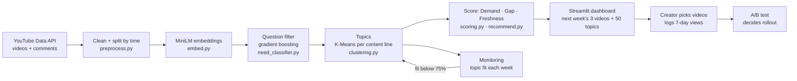

# 11. Deployment Plan

Slide 11.

## Architecture

- **Data source:** YouTube Data API, pulled once a week; the API key is kept in `.env`.
- **Pipeline:** `python -m src.pipeline --collect` runs every step as a weekly batch, about 10 minutes on a laptop.
- **Model serving:**
  - batch only; the saved filter model and topic centres score the new comments;
  - results are written to CSV files that the Streamlit dashboard reads.

## Retraining and drift detection
| What | Check | Action |
|---|---|---|
| **Topic fit** | share of new questions that fit a topic (Jul–Sep: 90%; October: 78–88%) | **below 75% → re-cluster**; otherwise re-cluster monthly |
| Question share | share of comments the filter keeps | outside 8–25% → check the filter |
| Filter | new labels (500 more planned) | retrain and re-test on fresh, time-split data |

## A/B test before full rollout
| | Plan |
|---|---|
| Unit | one video |
| **Control (A)** | the **most-asked** topic in the content line |
| **Treatment (B)** | **our pick**: the Top 3 by opportunity score |
| Assignment | each week, one A video and one B video in the same content line; same format, length and upload time |
| **Primary metric** | **views after 7 days**, divided by the channel's usual 7-day views |
| Guardrails | unsubscribes per video, creator hours per video |
| Duration | at least **8 weeks**, at least 12 videos per group |
| **Rollout** | B ≥ **1.1×** A, with the confidence interval above 1.0 → keep the ranking |
| **Rollback** | B below 0.9× A, or a guardrail clearly worse → rank by demand only |

With 12 videos per group, 8 weeks shows a direction, not proof. If the result sits near a threshold, keep logging.
